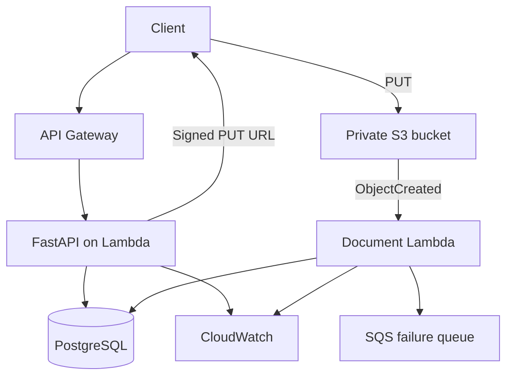
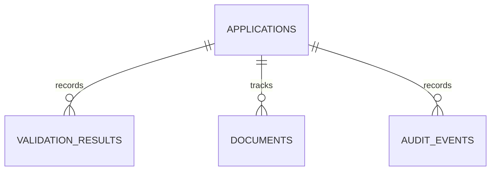

# MortgageFlow

MortgageFlow is a FastAPI backend for practicing mortgage application processing with synthetic data. Applicants create and submit records, attach dummy documents, and track progress. Reviewers move records through a simulated workflow. The versioned DTI rule returns example review flags for educational use.

## Run locally

Prerequisites are Docker with Compose, curl, and jq.

```sh
cp .env.example .env
docker compose up --build -d
curl --fail http://localhost:8000/ready
```

Open [Swagger UI](http://localhost:8000/docs) to try the API. The PostgreSQL volume persists applications across restarts. Compose also starts a local S3 emulator.

```sh
BASE=http://localhost:8000
APPLICANT=demo-applicant-local-token-0001
REVIEWER=demo-reviewer-local-token-00001
APP_ID=$(curl -fsS -X POST "$BASE/v1/applications" \
  -H "Authorization: Bearer $APPLICANT" -H 'Content-Type: application/json' \
  --data-binary @examples/application.json | jq -er .id)
APP="$BASE/v1/applications/$APP_ID"

curl -fsS -X POST "$APP/validate" -H "Authorization: Bearer $APPLICANT" | jq
curl -fsS -X POST "$APP/submit" -H "Authorization: Bearer $APPLICANT" | jq
curl -fsS -X POST "$APP/review" -H "Authorization: Bearer $REVIEWER" \
  -H 'Content-Type: application/json' -d '{"status":"IN_REVIEW"}' | jq
```

The sample validation returns DTI **34.67%**. The default threshold is **43.00%**. A rounded DTI above the threshold gets the `REVIEW_DTI` flag. Required fields are enforced at creation and explicit nulls are rejected on updates. The stored application therefore has all required fields before validation.

### Upload a dummy document

```sh
SIZE=$(wc -c < examples/dummy.txt | tr -d ' ')
UPLOAD=$(curl -fsS -X POST "$APP/documents/upload-url" \
  -H "Authorization: Bearer $APPLICANT" -H 'Content-Type: application/json' \
  -d "{\"filename\":\"dummy.txt\",\"mime_type\":\"text/plain\",\"size_bytes\":$SIZE}")
curl -fsS -X PUT "$(jq -er .url <<<"$UPLOAD")" \
  -H 'Content-Type: text/plain' -H "Content-Length: $SIZE" -H 'If-None-Match: *' \
  --data-binary @examples/dummy.txt
docker compose exec api python -m scripts.replay_upload "$(jq -er .document_id <<<"$UPLOAD")"
curl -fsS "$APP/status" -H "Authorization: Bearer $APPLICANT" | jq
curl -fsS "$APP/audit" -H "Authorization: Bearer $APPLICANT" | jq
```

The Compose replay invokes the same handler used by AWS. Replay the notification twice to see that only one processing audit entry appears. The upload URL lasts five minutes and is bound to its content type, length and unique key. Use a fresh URL when the old one expires. Document processing checks the uploaded object's metadata and size.

### Run the scripted demo

With Compose running and the development dependencies installed, run the same sequence with:

```sh
DEMO_APPLICANT_TOKEN=demo-applicant-local-token-0001 \
DEMO_REVIEWER_TOKEN=demo-reviewer-local-token-00001 python -m scripts.demo
```

## API

| Method | Endpoint | Access |
|---|---|---|
| POST | `/v1/applications` | Applicant |
| GET | `/v1/applications?status=DRAFT&limit=25&offset=0` | Owner-scoped applicant or reviewer |
| GET | `/v1/applications/{id}` | Owner or reviewer |
| PATCH | `/v1/applications/{id}` | Owner, in draft or needs info |
| POST | `/v1/applications/{id}/validate` | Owner or reviewer |
| GET | `/v1/applications/{id}/validations?limit=25&offset=0` | Owner or reviewer, newest first |
| POST | `/v1/applications/{id}/submit` | Owner |
| POST | `/v1/applications/{id}/review` | Reviewer |
| POST | `/v1/applications/{id}/documents/upload-url` | Owner |
| GET | `/v1/applications/{id}/status` | Owner or reviewer |
| GET | `/v1/applications/{id}/audit` | Owner or reviewer |
| GET | `/health`, `/ready` | Operational probes |

Application writes and their audit events commit together. Errors include a machine-readable code, message, correlation ID, and field details where applicable. Applicant access to another applicant's record returns 404. Request and worker logs avoid financial values, document bytes, tokens, and signed URLs.

## Architecture





Lambda and Mangum keep the API deployment small and let S3 invoke the worker asynchronously. This introduces cold starts and creates short-lived database connections. RDS provides the same PostgreSQL behavior as the local setup and supports a private TLS endpoint. Local Compose avoids the recurring cost of RDS and VPC connectivity during development.

## Tests and deployment

```sh
python3.12 -m venv .venv
source .venv/bin/activate
pip install -r requirements-dev.txt
ruff check .
ruff format --check .
mypy app workers scripts
python -m pytest --cov=app --cov=workers --cov-report=term-missing
```

Set `TEST_DATABASE_URL` to an empty, disposable PostgreSQL database to run the migration and integration suite against PostgreSQL. The fixture upgrades, downgrades, and clears the test schema. Without this variable, tests use temporary SQLite with foreign keys enabled.

- [AWS setup, monitoring, cost, and teardown](docs/aws.md)
- [Testing and performance evidence](docs/verification.md)

Use synthetic aliases, amounts, and documents only. Demo tokens are plain bearer tokens for local development. Generate unique tokens for a deployed demo and store them in Secrets Manager. The simulated reviewer role has access to all applications. Uploads are checked by extension, declared type and size, with no content inspection.
