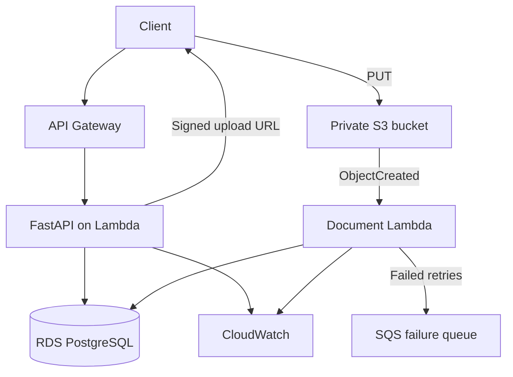
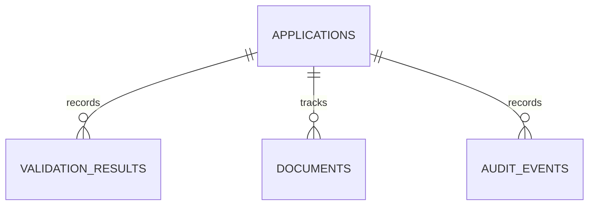

# MortgageFlow

MortgageFlow is a backend for a simulated mortgage application workflow. An applicant creates a draft, checks an example debt-to-income (DTI) rule, uploads a dummy document, and submits the application. A reviewer can inspect validation history, request more information, and complete the review.

**Use synthetic data only.** Validation flags are educational examples. Keep real borrower information and documents out of the demo.

## Quick start

Install Docker with Compose, then run:

```sh
git clone https://github.com/MadanMohan0537/mortgageflow.git
cd mortgageflow
cp .env.example .env
docker compose up --build -d
curl -fsS http://localhost:8000/ready
```

The API applies its Alembic migrations and initializes the LocalStack S3 bucket on startup. Once `/ready` returns `{"status":"ready"}`, open [Swagger UI](http://localhost:8000/docs) and select **Authorize**. Use one of the local demo tokens from `.env.example`.

| Role | Local bearer token | Scope |
|---|---|---|
| Applicant | `demo-applicant-local-token-0001` | Create and manage their own applications |
| Reviewer | `demo-reviewer-local-token-00001` | Review applications and read their history |

Run `docker compose logs api` to inspect startup errors. Run `docker compose down` to stop the stack and keep the PostgreSQL volume.

## Try the workflow

The sample application uses $90,000 in annual income, $800 in monthly debt, and a $1,800 proposed housing payment. The Decimal calculation returns **34.67% DTI**. A rounded DTI above the default **43.00%** threshold adds a `REVIEW_DTI` flag.

With the development dependencies installed, the scripted demo creates the application, validates it, starts review, uploads a dummy file, and completes the review. It also checks that replaying the upload event twice yields one processing audit event.

```sh
DEMO_APPLICANT_TOKEN=demo-applicant-local-token-0001 \
DEMO_REVIEWER_TOKEN=demo-reviewer-local-token-00001 \
python -m scripts.demo
```

<details>
<summary>Walk through the API with curl and jq</summary>

```sh
BASE=http://localhost:8000
APPLICANT=demo-applicant-local-token-0001
REVIEWER=demo-reviewer-local-token-00001
APP_ID=$(curl -fsS -X POST "$BASE/v1/applications" \
  -H "Authorization: Bearer $APPLICANT" -H 'Content-Type: application/json' \
  --data-binary @examples/application.json | jq -er .id)
APP="$BASE/v1/applications/$APP_ID"

curl -fsS -X POST "$APP/validate" -H "Authorization: Bearer $APPLICANT" | jq
curl -fsS -X POST "$APP/submit" -H "Authorization: Bearer $APPLICANT" | jq
curl -fsS -X POST "$APP/review" -H "Authorization: Bearer $REVIEWER" \
  -H 'Content-Type: application/json' -d '{"status":"IN_REVIEW"}' | jq

SIZE=$(wc -c < examples/dummy.txt | tr -d ' ')
UPLOAD=$(curl -fsS -X POST "$APP/documents/upload-url" \
  -H "Authorization: Bearer $APPLICANT" -H 'Content-Type: application/json' \
  -d "{\"filename\":\"dummy.txt\",\"mime_type\":\"text/plain\",\"size_bytes\":$SIZE}")
curl -fsS -X PUT "$(printf '%s\n' "$UPLOAD" | jq -er .url)" \
  -H 'Content-Type: text/plain' -H "Content-Length: $SIZE" -H 'If-None-Match: *' \
  --data-binary @examples/dummy.txt
docker compose exec api python -m scripts.replay_upload "$(printf '%s\n' "$UPLOAD" | jq -er .document_id)"
curl -fsS "$APP/status" -H "Authorization: Bearer $APPLICANT" | jq
curl -fsS "$APP/audit" -H "Authorization: Bearer $APPLICANT" | jq
```

The local replay command invokes the same document handler used by Lambda. After replay, the status response should show the document as `PROCESSED`. Request a fresh upload URL if the old one expires.

</details>

## API reference

| Method | Endpoint | Access |
|---|---|---|
| POST | `/v1/applications` | Applicant |
| GET | `/v1/applications?status=DRAFT&limit=25&offset=0` | Owner-scoped applicant or reviewer |
| GET | `/v1/applications/{id}` | Owner or reviewer |
| PATCH | `/v1/applications/{id}` | Owner, in draft or needs info |
| POST | `/v1/applications/{id}/validate` | Owner or reviewer |
| GET | `/v1/applications/{id}/validations?limit=25&offset=0` | Owner or reviewer, newest first |
| POST | `/v1/applications/{id}/submit` | Owner |
| POST | `/v1/applications/{id}/review` | Reviewer |
| POST | `/v1/applications/{id}/documents/upload-url` | Owner |
| GET | `/v1/applications/{id}/status` | Owner or reviewer |
| GET | `/v1/applications/{id}/audit` | Owner or reviewer |
| GET | `/health`, `/ready` | Operational probes |

The normal lifecycle is `DRAFT → SUBMITTED → IN_REVIEW → COMPLETED`. A reviewer can move an application to `NEEDS_INFO` from `IN_REVIEW`. The applicant can edit and resubmit it to return to review.

Errors include a code, message, and correlation ID, with field details when available. Requests for another applicant’s record return HTTP 404.

## Architecture

Local development runs FastAPI, PostgreSQL, and LocalStack through Docker Compose. The AWS SAM template packages FastAPI with Mangum behind API Gateway and configures private RDS PostgreSQL, S3, a separate document Lambda, CloudWatch monitoring, and an SQS failure queue.





Application changes and their audit events commit in the same transaction. Upload URLs expire after five minutes and bind the object key, content type, and length. The worker checks object metadata and uses the document state and a row lock to handle duplicate notifications. Document bytes stay in S3.

## Development and verification

Use Python 3.12 for local checks:

```sh
python3.12 -m venv .venv
. .venv/bin/activate
python -m pip install -r requirements-dev.txt
ruff check .
ruff format --check .
mypy app workers scripts
python -m pytest --cov=app --cov=workers --cov-report=term-missing --cov-fail-under=85
```

Tests default to temporary SQLite with foreign keys enabled. Set `TEST_DATABASE_URL` to an **empty, disposable PostgreSQL database** to exercise the PostgreSQL path. The test fixture upgrades, downgrades, and clears the schema.

- **24 tests passed** on PostgreSQL and SQLite. [GitHub Actions run](https://github.com/MadanMohan0537/mortgageflow/actions/runs/43608038940)
- The local HTTP smoke test verified signed uploads, duplicate delivery, and a complete review. The authenticated list benchmark measured **25.64 ms p50** and **36.44 ms p95** over 300 local requests at concurrency eight. [Method and dataset](docs/verification.md)
- The SAM template passed static validation. Live AWS deployment and S3-to-Lambda delivery still need verification. [AWS deployment, monitoring, and teardown](docs/aws.md)

## Demo boundaries

The local bearer tokens are shared examples. Generate unique credentials for an AWS demo and store them in Secrets Manager. The simulated reviewer role can access all applications. The worker checks extension, declared type, and size. File content inspection is outside the scope of the demo.
